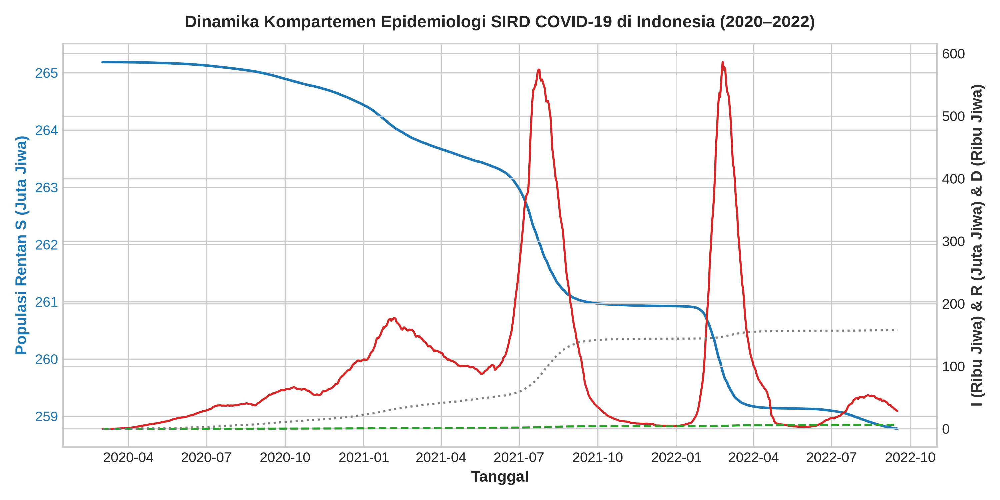
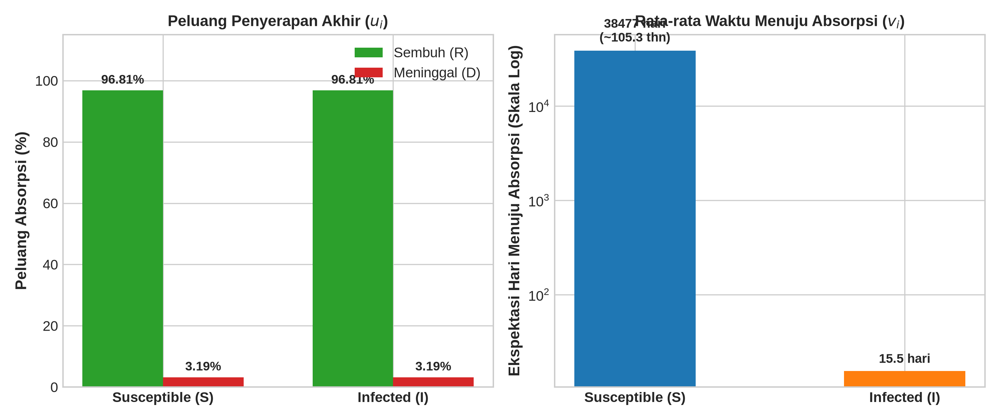

# Pemodelan Rantai Markov Waktu Diskret Berkeadaan Penyerap untuk Dinamika Penularan COVID-19 di Indonesia

[](https://www.python.org/)
[](https://jupyter.org/)
[](code/tests)
[](LICENSE)
[](report/laporan.pdf)

Penelitian ini memodelkan dinamika penularan COVID-19 di Indonesia menggunakan pendekatan stokastik rantai Markov waktu diskret berkeadaan penyerap (absorbing Markov chain). Parameter peluang transisi diestimasi langsung dari deret waktu empiris 929 hari observasi nasional (2 Maret 2020 sampai 16 September 2022) untuk menghitung durasi rata-rata perawatan pasien aktif, probabilitas kesembuhan akhir, dan tingkat fatalitas kasus.

---

## Ringkasan eksekutif dan temuan utama

Dengan mengelompokkan populasi ke dalam empat kompartemen epidemiologi (Rentan, Terinfeksi, Sembuh, Meninggal), model menghasilkan parameter estimasi sebagai berikut:

| Parameter evaluasi | Nilai model | Data rujukan lapangan | Interpretasi hasil |
| :--- | :---: | :---: | :--- |
| **Durasi Rata-rata Sakit ($v_I$)** | **15,45 hari** | 10 sampai 14 hari | Konsisten dengan standar protokol isolasi mandiri Kemenkes RI dan perhimpunan dokter spesialis. |
| **Peluang Sembuh Pasien Aktif ($u_I^{(R)}$)** | **96,81%** | 96,7% sampai 97,5% | Menggambarkan tingkat pemulihan pasien terinfeksi aktif pada skala nasional. |
| **Peluang Mortalitas Pasien Aktif ($u_I^{(D)}$)** | **3,19%** | 2,5% sampai 3,3% | Bersesuaian dengan rentang Case Fatality Rate (CFR) kumulatif nasional selama pandemi. |
| **Waktu Tunggu Penyerapan Rentan ($v_S$)** | **38.477 hari** | Laju per kapita $P_{SI} \approx 2{,}6 \times 10^{-5}$ | Rata-rata waktu transmisi individu rentan pada basis populasi tertutup 265 juta jiwa. |

Seluruh perhitungan diselesaikan melalui dua pendekatan mandiri: penurunan analitis First Step Analysis (FSA) dan dekomposisi matriks fundamental Kemeny-Snell ($N = (I - Q)^{-1}$). Kedua pendekatan memberikan hasil numerik yang konsisten hingga digit presisi terakhir.

---

## Visualisasi data dan dinamika kompartemen

| Dinamika deret waktu SIRD (2020-2022) | Hasil First Step Analysis ($u_i, v_i$) |
| :---: | :---: |
|  |  |

---

## Metodologi dan formulasi matematis

### 1. Sumber data dan rekonstruksi kompartemen
Data empiris mencakup 929 observasi harian nasional yang dihimpun oleh Satuan Tugas Penanganan COVID-19 dan Kementerian Kesehatan Republik Indonesia. Populasi dimodelkan secara tertutup dengan jumlah penduduk tetap $N = 265.185.520$ jiwa.

Variabel acak $X_n$ menyatakan status kesehatan individu pada hari ke-$n$ dengan ruang keadaan:
$$S = \{S, I, R, D\}$$
- Keadaan transien: $S$ (Susceptible / Rentan) dan $I$ (Infected / Terinfeksi aktif).
- Keadaan penyerap (absorbing): $R$ (Recovered / Sembuh) dan $D$ (Death / Meninggal dunia). Sifat penyerap berlaku karena individu yang meninggal tidak dapat berpindah keadaan, dan individu yang sembuh diasumsikan memiliki proteksi imun selama kurun waktu pengamatan model.

### 2. Estimasi matriks transisi kanonik
Peluang transisi dihitung berdasarkan rata-rata rasio harian selama 929 hari kalender:
- Peluang infeksi baru dari rentan: $P_{SI} = 0{,}000026$, sehingga $P_{SS} = 1 - P_{SI} = 0{,}999974$.
- Peluang kesembuhan harian: $P_{IR} = 0{,}062643$.
- Peluang kematian harian: $P_{ID} = 0{,}002064$.
- Peluang tetap terinfeksi: $P_{II} = 1 - P_{IR} - P_{ID} = 0{,}935293$.
- Keadaan penyerap: $P_{RR} = 1$ dan $P_{DD} = 1$.

Struktur matriks peluang transisi kanonik $P$:

$$P = \begin{pmatrix} Q & R \\ \mathbf{0} & I \end{pmatrix} = \begin{pmatrix} 0{,}999974 & 0{,}000026 & 0 & 0 \\ 0 & 0{,}935293 & 0{,}062643 & 0{,}002064 \\ 0 & 0 & 1 & 0 \\ 0 & 0 & 0 & 1 \end{pmatrix}$$

Seluruh elemen matriks memenuhi $P_{ij} \ge 0$ dan jumlahan setiap baris bernilai tepat 1,000, sehingga memenuhi syarat mutlak matriks stokastik.

### 3. Penurunan First Step Analysis (FSA)
Probabilitas penyerapan ke status sembuh ($u_i$) memenuhi sistem persamaan langkah pertama:
$$u_I = P_{II} u_I + P_{IR}(1) + P_{ID}(0) \implies (1 - 0{,}935293) u_I = 0{,}062643 \implies u_I \approx 0{,}9681$$
$$u_S = P_{SS} u_S + P_{SI} u_I \implies (1 - 0{,}999974) u_S = 0{,}000026(0{,}9681) \implies u_S \approx 0{,}9681$$

Waktu rata-rata penyerapan ($v_i$) memenuhi:
$$v_I = 1 + P_{II} v_I \implies (1 - 0{,}935293) v_I = 1 \implies v_I \approx 15{,}4543 \text{ hari}$$
$$v_S = 1 + P_{SS} v_S + P_{SI} v_I \implies v_S = \frac{1}{0{,}000026} + 15{,}4543 \approx 38.476{,}99 \text{ hari}$$

### 4. Validasi silang teori matriks fundamental Kemeny-Snell
Dekomposisi matriks fundamental mengonfirmasi hasil analitis:
$$N = (I - Q)^{-1} = \begin{pmatrix} 38.461{,}54 & 15{,}4543 \\ 0 & 15{,}4543 \end{pmatrix}$$
$$B = N R = \begin{pmatrix} 0{,}9681 & 0{,}0319 \\ 0{,}9681 & 0{,}0319 \end{pmatrix}$$
$$\mathbf{v} = N \mathbf{1} = \begin{pmatrix} 38.476{,}99 \\ 15{,}4543 \end{pmatrix}$$

Matriks $B$ membuktikan bahwa peluang terserap ke status sembuh adalah 96,81% dan ke status meninggal adalah 3,19%, baik bagi individu yang berada di kelompok terinfeksi maupun rentan yang tertular kemudian.

---

## Pembahasan dan implikasi kebijakan kesehatan

1. **Estimasi Bed Occupancy Rate (BOR)**: Durasi sakit $v_I \approx 15{,}45$ hari merupakan input kuantitatif bagi manajemen rumah sakit untuk memproyeksikan kebutuhan tempat tidur perawatan intensif dan ketersediaan tabung oksigen saat terjadi lonjakan kasus.
2. **Efektivitas intervensi penularan**: Peluang transmisi per kapita $P_{SI} = 0{,}000026$ yang tampak kecil tetap menghasilkan akumulasi kasus nyata saat dikalikan dengan basis penduduk rentan sebanyak 265 juta jiwa. Fakta ini menegaskan bahwa kebijakan intervensi non-farmakologis (PSBB/PPKM dan protokol 3M) sangat relevan dalam menahan laju penularan pada fase awal wabah.
3. **Korelasi dengan Case Fatality Rate**: Peluang serapan akhir menuju kematian sebesar 3,19% konsisten dengan angka mortalitas agregat nasional Indonesia yang berada pada kisaran 2,5% sampai 3,3%.

---

## Evaluasi kritis keterbatasan asumsi Markov

1. **Sifat nir-memori (memoryless)**: Model mengasumsikan peluang kesembuhan pada hari ke-14 sama dengan hari pertama infeksi. Kenyataannya, beban virus (viral load) dan respon antibodi pasien berkembang secara dinamis seiring pertambahan durasi infeksi.
2. **Homogenitas waktu**: Nilai parameter diperlakukan konstan sepanjang 929 hari kalender, padahal laju penyebaran di lapangan berubah akibat mutasi virus (varian Delta dan Omicron), pembatasan mobilitas, dan perluasan program vaksinasi nasional.
3. **Rekomendasi pengembangan**: Pemodelan lanjutan dapat menerapkan rantai semi-Markov dengan distribusi waktu tinggal Weibull atau regresi Cox multi-keadaan untuk memasukkan faktor umur dan riwayat komorbiditas medis.

---

## Panduan eksekusi dan verifikasi komputasi

### 1. Kloning repositori
```bash
git clone https://github.com/ramadhan-imanur/absorbing-markov-chain-covid19-indonesia.git
cd absorbing-markov-chain-covid19-indonesia
```

### 2. Instalasi dependensi
Gunakan Python 3.10 atau versi yang lebih baru:
```bash
pip install -r requirements.txt
```

### 3. Pengujian otomatis
Jalankan pengujian unit berbasis pytest untuk memvalidasi seluruh kalkulasi matriks dan FSA:
```bash
pytest code/tests/ -v
```

### 4. Eksekusi skrip verifikasi
Jalankan skrip independen untuk memverifikasi matriks fundamental di terminal:
```bash
python3 code/scripts/verify_sird_calculation.py
```

### 5. Menjalankan Jupyter Notebook
Untuk meninjau eksplorasi data harian dan penurunan simbolis SymPy secara bertahap:
```bash
jupyter notebook code/notebooks/
```
- `01_fenomena_dan_data.ipynb`: Pembersihan data mentah dan penaksiran parameter transisi empiris.
- `02_first_step_analysis.ipynb`: Perhitungan simbolis SymPy dan penyelesaian numerik matriks fundamental.

---

## Spesifikasi teknologi

- **Bahasa**: Python 3.10+
- **Manipulasi data**: Pandas, NumPy
- **Komputasi simbolis dan numerik**: SymPy, SciPy
- **Pengujian otomatis**: Pytest
- **Visualisasi data**: Matplotlib, Seaborn
- **Laporan ilmiah**: LaTeX (TeX Live)

---

## Tim peneliti dan konteks akademik

Penelitian ini disusun sebagai bagian dari studi proses stokastik terapan pada Program Studi S1 Matematika, Fakultas Matematika dan Ilmu Pengetahuan Alam (FMIPA), Universitas Sebelas Maret (UNS).

**Kelompok 1:**
- Fadhila Hardi Ningrum (M0124004)
- Karunia Febyayu Puspitaningtyas (M0124010)
- Ramadhan Imanur Rochim (M0124015)
- Achika Vigo Azhyra (M0125001)
- Fawwaz Absyar Rifai (M0125044)

**Dosen Pengampu:** Ade Susanti, S.Si., M.Si.
